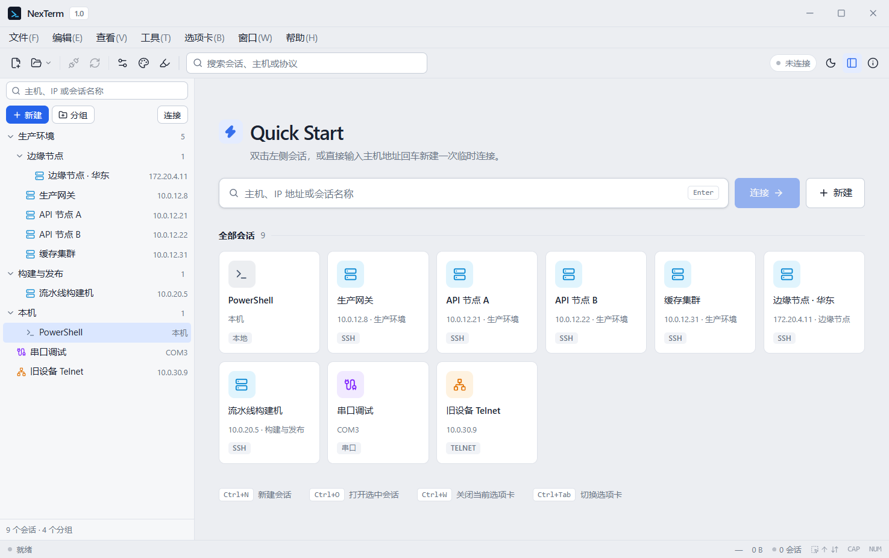
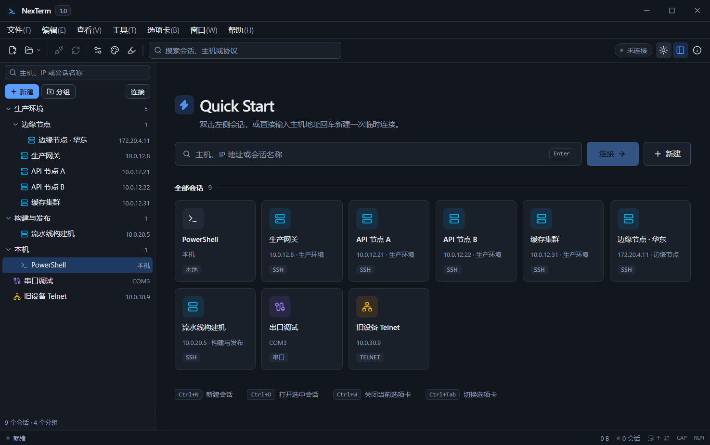
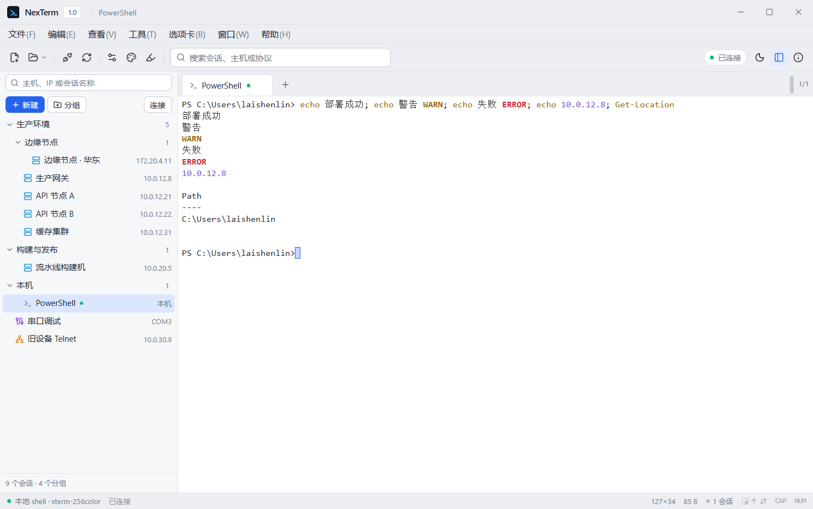
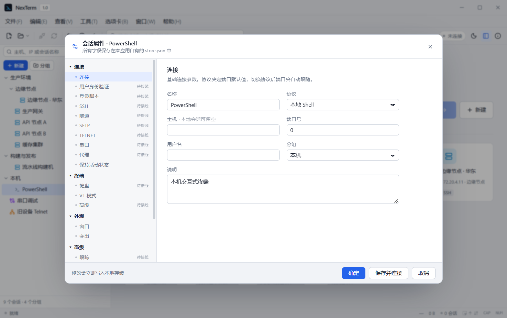
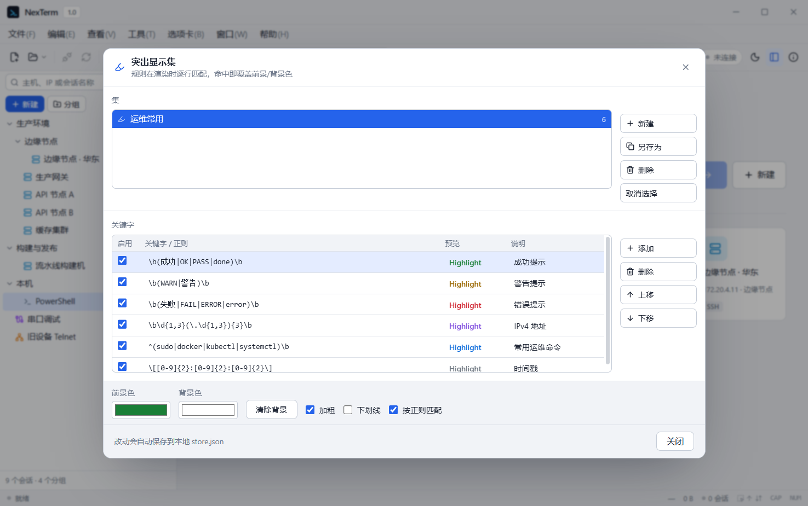
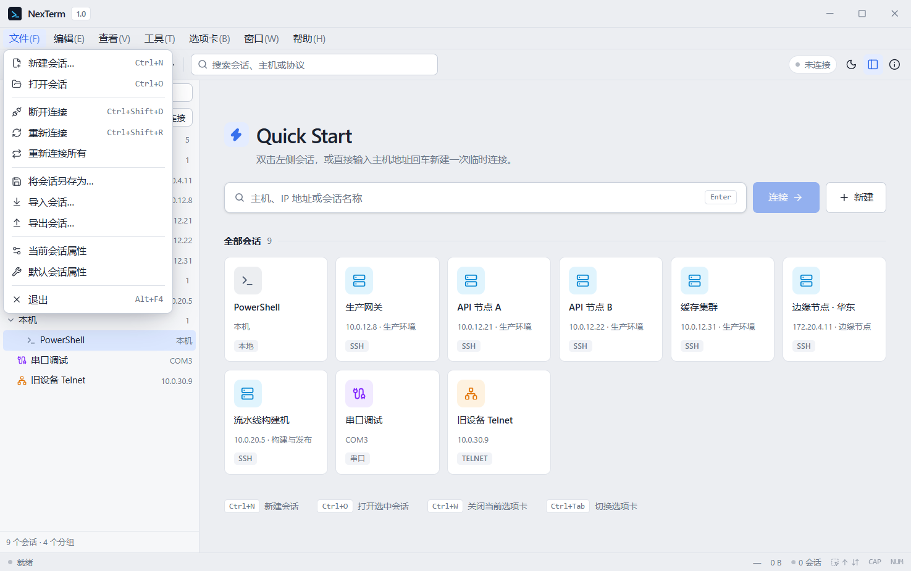

# NexTerm

一个**独立实现**的跨平台终端客户端桌面应用：Tauri 2 + Rust + React 19 + TypeScript + Tailwind CSS 4 + Lucide + Sonner。

界面结构参考了常见桌面终端工具的信息架构（标题栏 / 菜单栏 / 工具栏 / 会话面板 / 标签栏 / 终端 / 状态栏 / 属性对话框 / 高亮集对话框），但**代码、数据模型、存储格式、终端内核全部为本项目自有实现**，不读取、不解析、不依赖任何第三方终端软件的配置文件或数据结构。



---

## 1. 关键约束：数据层完全独立

| 维度 | 本项目的做法 |
| --- | --- |
| 存储位置 | `%APPDATA%\app.nexterm.desktop\store.json`，单文件 JSON |
| 结构定义 | `crates/nexterm-core/src/model.rs` 中的 `Store / Session / Folder / Palette / HighlightSet` |
| 颜色表示 | `#rrggbb` 字符串（不用任何平台相关的整数色值） |
| 外部格式 | **零**导入、零解析、零兼容层；不读注册表、不读其他软件的安装目录 |
| 依赖关系 | `nexterm-core` 不依赖 Tauri / GUI / 平台库，可脱离界面单独测试 |

`store.json` 的顶层结构：

```json
{
  "schema": 1,
  "folders": [{ "id": "f-prod", "name": "生产环境", "parent": null }],
  "sessions": [{ "id": "s-gw", "name": "生产网关", "protocol": "ssh", "host": "10.0.12.8", "port": 22, "...": "..." }],
  "palettes": [{ "id": "nexterm-light", "background": "#ffffff", "ansi": ["#24292f", "..."] }],
  "highlight_sets": [{ "id": "ops-basic", "rules": [{ "pattern": "\\b(成功|OK)\\b", "regex": true, "foreground": "#1a7f37" }] }],
  "settings": { "theme": "light", "accent": "blue", "show_toolbar": true }
}
```

写入采用「临时文件 + 重命名」，崩溃不会留下半截文件；解析失败时把坏文件改名留档而不是静默覆盖。

---

## 2. 技术栈

| 层 | 选型 |
| --- | --- |
| 应用框架 | Tauri 2（`tauri 2.12`） |
| 后端 | Rust 1.82+（实测 1.100.0，`x86_64-pc-windows-gnu`） |
| 前端 | React 19 + TypeScript 5.9 + Vite 8 |
| 样式 | Tailwind CSS 4（`@tailwindcss/vite`，CSS 变量做设计令牌） |
| 图标 | Lucide（`lucide-react`） |
| 通知 | Sonner（`sonner`） |
| 终端 I/O | `portable-pty`（ConPTY / forkpty） |

---

## 3. 架构

```
nexterm/
├─ crates/nexterm-core/        # 数据层（不含 Tauri，可独立测试）
│  ├─ model.rs                 # 自有数据模型
│  ├─ store.rs                 # JSON 持久化 + 种子数据
│  └─ vt.rs                    # 终端网格与 VT 解析（含 DSR/DA 应答）
├─ src-tauri/                  # 桌面壳
│  ├─ pty.rs                   # 会话运行时：PTY + 读线程 + 共享写端
│  ├─ commands.rs              # 唯一 IPC 入口（全部 async）
│  └─ lib.rs                   # 装配
└─ src/                        # React 前端
   ├─ components/              # 标题栏/菜单/工具栏/面板/标签/终端/状态栏/起始页
   ├─ dialogs/                 # 属性、高亮集、配色、关于
   ├─ lib/                     # api 封装、类型、按键映射、高亮叠加
   └─ state/store.tsx          # 唯一状态源 + 命令分发
```

依赖方向单向：`core ← (pty, commands) ← 前端`。前端组件不直接调 `invoke`，全部经 `lib/api.ts`，便于替换 IPC 机制。

### 三个值得记录的实现要点

1. **命令必须是 `async`。** Tauri 的同步命令在主线程执行，而创建 PTY（ConPTY）会阻塞消息循环——一开始正是这个原因导致界面假死、后续 IPC 全部超时。
2. **终端要会「回话」。** shell 与全屏程序会先发 `ESC[6n` 问光标位置，收不到回应就一直等。我们实测到 PTY 只发出 `1b5b366e` 就静止，补上 DSR/DA 应答后立即出现提示符。写端因此做成 `Arc<Mutex<..>>`，读线程才能在锁外回写应答。
3. **锁内不杀进程。** 关闭标签时先在锁内把子进程摘出来，再在锁外 `kill`；否则 ssh 卡在认证时会把整个运行时锁住。

---

## 4. 功能范围

### 已实现（可用）

- **会话管理**：新建 / 编辑 / 删除会话，分组（可嵌套）、搜索过滤、右键菜单、创建副本
- **多标签终端**：打开 / 切换 / 关闭 / 关闭其他 / 关闭全部、中键关闭、右键菜单、连接状态点
- **真实终端**：ConPTY 承载本地 shell 与 `ssh`，VT 解析支持光标移动、擦除、滚动区、SGR（16 色 / 256 色 / 真彩）、CJK 双宽、UTF-8 跨包
- **配色方案**：3 套内置方案，按会话持久化，切换即时生效
- **突出显示集**：规则增删改、上下移动、正则/子串、**区分大小写**、前景/背景（可设为沿用终端底色）、
  加粗/斜体/下划线/删除线、行内实时匹配（多条命中时上方规则优先），并支持**导入 / 导出**（自有 JSON 格式）
  - 导入对字段做校验并重新分配 id，避免覆盖本地集合；导出可选当前集合或全部集合
- **终端交互**：鼠标拖拽选区（双击选词 / 三击选行）、选区反色、**复制**（Ctrl+Shift+C / 编辑菜单 / 右键菜单）、
  全选、粘贴、右键菜单、**回滚查看**（向上滚动翻看历史行，4000 行缓冲）、**查找字符串**（Ctrl+F，支持正则与大小写）
- **字体大小**：会话属性里的字号真正作用于终端渲染（含等宽字符测量与 PTY 行列同步）
- **凭证保存**：SSH 密码存放在**系统凭据管理器**（Windows 凭据管理器 / macOS 钥匙串 / Linux Secret Service），
  配置文件里只有 `save_password` 开关、绝无明文；连接时经 `SSH_ASKPASS` 指向自身完成自动应答（无凭据则回落到终端手动输入），
  验证方法可选 Password / Keyboard Interactive（控制 `PreferredAuthentications`）
- **属性对话框**：5 个分类 20 个页面，数据驱动渲染；未接线的页面明确列出缺什么
- **界面框架**：自绘标题栏与窗口按钮、7 个菜单（含二级菜单与勾选态）、工具栏、状态栏、Quick Start
- **主题**：浅色 / 深色 + 4 种强调色，全部走 CSS 变量
- **快捷键**：Ctrl+N/O/W/L/Tab、Ctrl+Shift+N/D/R/S、Ctrl+F（查找）、Ctrl+Shift+C/V/A（复制/粘贴/全选）等，
  终端聚焦时普通按键让位给终端控制符

### 未实现（有意留白，界面会说明原因）

Telnet（IAC 协商）、串口、SFTP、端口转发、按键映射、触发器、脚本、终端分屏、多窗口、会话导入导出。
每条在 `src/components/menus.ts` 的 `UNIMPLEMENTED` 与属性对话框的 `todo` 里都写了**具体缺什么**，而不是「敬请期待」。

> 说明：突出显示集的导入 / 导出使用本项目自有的 JSON 格式（`nexterm-highlight`），
> 与数据层"零兼容外部格式"的约束一致——它不是、也不解析任何第三方终端的配置。

---

## 5. 运行与构建

```bash
# 依赖
npm install

# 开发（Vite + Tauri 热重载）
npm run app:dev

# 只跑数据层测试
cargo test -p nexterm-core

# 发布：产出 exe + NSIS 安装包
npm run app:build
```

产物：

- `target/release/nexterm.exe`
- `installer/NexTerm-1.0.0-setup.exe`（Inno Setup 脚本 `packaging/nexterm.iss`）

### Windows + GNU 工具链备注

本机没有 MSVC，使用 `x86_64-pc-windows-gnu`。两处必须调整：

1. `src-tauri/Cargo.toml` 里 `crate-type = ["rlib"]`。保留 `cdylib` 时 MinGW 会为 DLL 自动导出全部符号，报 `export ordinal too large`。
2. 链接需要 mingw 的 `as.exe` / `dlltool.exe`，把它们所在目录放到 `PATH` 最前。

---

## 6. 界面还原对照

| 参考图元素 | 本项目落点 | 说明 |
| --- | --- | --- |
| 标题栏 + 窗口按钮 | `components/TitleBar.tsx` | 自绘（`decorations: false`），双击最大化 |
| 菜单栏 7 项与下拉 | `components/MenuBar.tsx` + `menus.ts` | 含图标、快捷键、勾选态、二级菜单 |
| 工具栏 | `components/Toolbar.tsx` | 与菜单共用命令 id，避免行为漂移 |
| 会话面板（搜索/新建/树） | `components/SessionPanel.tsx` | 分组可折叠、右键菜单、拖拽调宽 |
| Quick Start | `components/QuickStart.tsx` | 标题 + 搜索 + 卡片网格，响应式列数 |
| 标签栏 | `components/TabStrip.tsx` | 状态点、关闭按钮、中键关闭、右键菜单 |
| 终端 | `components/TerminalPane.tsx` | 网格渲染 + 高亮叠加 + 键盘映射 |
| 状态栏 | `components/StatusBar.tsx` | 连接态、尺寸、字节数、会话数、模式指示 |
| 会话属性对话框 | `dialogs/SessionDialog.tsx` | 左侧页面树 + 右侧表单（数据驱动） |
| 突出显示集对话框 | `dialogs/HighlightDialog.tsx` | 集合列表 + 关键字表 + 颜色设置 |

差异（不掩饰）：图标为 Lucide 线性图标而非原产品私有素材；对话框用自绘模态而非系统窗口；没有实现原产品的三处右键菜单全量条目。

---

## 7. 截图

| 起始页（浅色） | 深色主题 |
| --- | --- |
|  |  |

| 终端（真实 ConPTY + 高亮） | 会话属性 |
| --- | --- |
|  |  |

| 突出显示集 | 文件菜单 |
| --- | --- |
|  |  |

> 截图由 CDP 直接抓取 WebView2 渲染层（`tools-shot.cjs`），不是拼图或设计稿。

---

## 8. 许可

MIT。NexTerm 与任何商业终端软件无关联，界面结构参考属通用信息架构，代码与数据模型均为独立实现。
